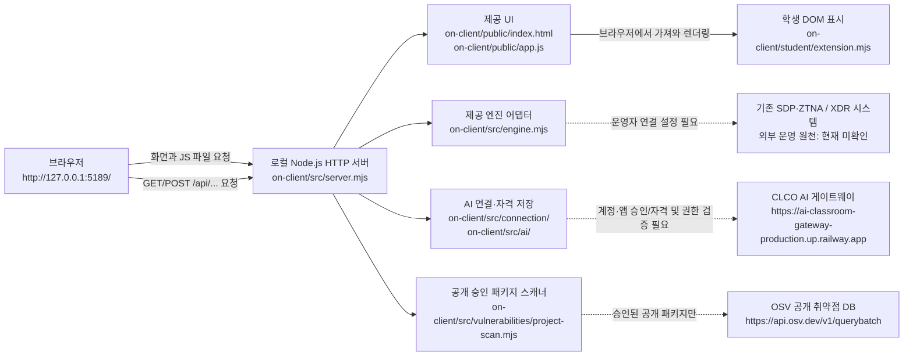

# KimJH 보안 Agent — 학생 실행 설명서 및 시스템 구성도 (21단계)

> **문서 범위:** 현재 저장소의 `on-client` 애플리케이션, 기존 13~20단계 학생 표시 기능, 2026-10-27까지 관찰한 로컬 동작. **21단계 공식 통과(2026-10-27 15:30 KST)**를 확인했습니다. 22단계 별도 폴더 실행·미확인 기능은 [STUDENT_RELEASE_RECORD.md](STUDENT_RELEASE_RECORD.md)에 구분해 기록합니다. 제공 문서와 서버 코드를 덮어쓰지 않았습니다.

## 1. 목적·지원 환경과 증거 수준

KimJH는 사용자 본인의 로그인·기기·세션 상태, 업무 앱 접근 판정, 접속/XDR 기록, AI의 근거 설명과 조치 제안, 설치 패키지 OSV 조회 결과를 **보여 주는** 로컬 보안 Agent입니다. 접근 허용·차단, XDR 탐지, 실제 조치 집행의 권위는 기존 SDP/원천 시스템에 있습니다. AI의 제안은 집행 명령이 아닙니다.

| 항목 | 확인한 값 | 확인 수준 / 한계 |
| --- | --- | --- |
| 실행 OS·셸 | Windows PC, PowerShell | 학생 PC에서 사용함. Windows 세부 버전 및 다른 OS 지원은 미확인 |
| Node.js | `v24.19.0` | 학생 PC에서 버전 확인, 실행 도구는 Node.js 22~24 허용, `on-client/package.json`의 `engines.node`는 `24.19.0` |
| 앱 패키지 | `alekov-client-starter` `0.2.11` | `on-client/package.json` 원문 확인 |
| Git | `git pull --ff-only origin main` 성공 | 실제 학생 PC에서 확인, Git 자체 버전 미확인 |
| JavaScript 검사 | `npm.cmd --prefix <on-client 절대 경로> run check` 성공 | 학생 PC에서 20단계 코드의 문법 검사까지 확인; 전체 회귀 시험은 아님 |
| 로컬 앱 주소 | `http://127.0.0.1:5189/` | 학생 PC에서 브라우저 화면과 `/api/vulnerabilities` GET 200 확인 |
| 브라우저 | Windows의 Microsoft Edge 화면 확인 | 브라우저 정확한 버전·타 브라우저 재현은 미확인 |
| 외부 npm 의존성 | `on-client/package.json`에 dependencies/devDependencies 없음 | 코드·매니페스트 확인. 저장소 최상위 `package.json`의 의존성과 혼동하지 않음 |
| OSV 조회 | `not_configured` / `PROJECT_NOT_CONFIGURED` | 실제 화면 확인. 설치 패키지별 조회와 취약점 탐지는 미확인 |
| AI | ALEPH 계정 확인·포털 앱 승인 화면까지 진행 | 앱에서 `ALEKOV_CONNECT_OUTCOME_UNKNOWN`, 모델 점검 `ON_AI_PROVISIONING_PENDING`; 사용 권한·모델 응답·실제 설명은 성공으로 인정하지 않음 |
| SDP·XDR·조치 | 기존 엔진의 연동 경로 존재 | 로컬에서 `/api/events`·`/api/devices`·`/api/sessions` 503 관찰. 실제 원천 연결·조치 집행은 미확인 |

`on-client`은 브라우저 화면과 학생 표시를 시작하기 위해 별도의 `npm install`이 필요하다고 선언하지 않습니다. **Git 저장소 최상위**에는 예전 단계의 `package.json`과 `package-lock.json`이 있지만 **`on-client` 내부에는 `package-lock.json`이 없습니다.** 이 차이를 이용해 OSV 검사 대상을 임의 지정하거나 패키지 버전을 낮추지 않습니다.

## 2. 실제 작업 위치와 폴더 구조

학생 PC에서 실제 사용한 Git 저장소는 Windows 사용자 홈의 `OneDrive\Desktop\SKT ALEPH\choi-bujang-secret-vault`입니다. 개인정보가 들어가는 사용자 계정명 대신 `$env:USERPROFILE`로 경로를 작성합니다.

```text
<사용자 홈>\OneDrive\Desktop\SKT ALEPH\choi-bujang-secret-vault\  ← Git 최상위, 기존 1~12단계 보존
├── .git\                          ← Git 이력 (로컬)
├── README.md                      ← 기존 단계 설명; 학생 21단계 문서로 대체하지 않음
├── aleph.config.json              ← 기존 단계 설정, on-client 실행용 Native Host 설정이 아님
├── package.json / package-lock.json  ← 기존 최상위 프로젝트
└── on-client\                     ← KimJH 학생 앱의 실제 실행 폴더
    ├── README.md                  ← 학생 실행 설명서 링크
    ├── package.json              ← alekov-client-starter 0.2.11, start/demo/check
    ├── tools\
    │   ├── start-alekov.ps1      ← 서버 실행·포트/Node 확인
    │   ├── prepare-native-host.ps1  ← 별도 Native Host 준비 도구
    │   ├── native-host-registry.ps1
    │   └── app-credentials.ps1
    ├── public\
    │   ├── index.html            ← 화면/버튼 이름
    │   ├── app.js                ← 제공 UI, 요청·취소·응답 세대 관리
    │   ├── ai-connect.mjs        ← 제공 계정/AI 연결 UI
    │   └── vulnerabilities-view.mjs
    ├── src\
    │   ├── server.mjs            ← 로컬 HTTP 서버, API 라우팅
    │   ├── engine.mjs            ← SDP 엔진 어댑터/예제/미연결
    │   ├── engine\               ← SDP 호스트 연결부
    │   ├── connection\           ← 계정·앱 승인 및 Native Host 연결부
    │   ├── ai\                   ← AI 권한·게이트·자격 저장 연동
    │   ├── actions\              ← 사람 확인·원천 조치 요청/결과 연결부
    │   └── vulnerabilities\      ← 설치 버전 검증 및 OSV 조회
    ├── student\
    │   └── extension.mjs         ← 학생이 구현한 render* 표시 함수
    └── docs\
        └── STUDENT_RUNBOOK.md    ← 이 학생 문서 (글 구성도 포함)
```

개인 Native Host 설정 파일은 실제 사용했던 `$env:LOCALAPPDATA\KimJH-NativeHost\native.json` 경로에 **프로젝트 밖**으로 보관합니다. 이 경로는 설정값이 아니며 파일 내용·비밀번호·토큰·인증서는 문서·채팅·커밋·제출 원문에 넣지 않습니다. `-SdpHostConfig`는 별도의 운영자 제공 파일이 필요하며 학생 PC에서 그 실제 연동 성공은 확인하지 못했습니다.

## 3. 처음 또는 새 PowerShell 창에서 실행

### 3-1. 필수 프로그램과 위치 확인

Node.js `v24.19.0`, Git, PowerShell, 로컬 브라우저를 준비합니다. 아래 명령은 **Windows PowerShell에 입력**합니다. 이미 내려받은 프로젝트를 **삭제하거나 새로 생성하지 않습니다.** 파일 탐색기에서 `on-client` 폴더 주소창에 `powershell`을 입력해 같은 위치에서 열어도 됩니다.

```powershell
$ProjectRoot = Join-Path $env:USERPROFILE 'OneDrive\Desktop\SKT ALEPH\choi-bujang-secret-vault'
$AppRoot = Join-Path $ProjectRoot 'on-client'
Test-Path -LiteralPath (Join-Path $AppRoot 'tools\start-alekov.ps1')
Test-Path -LiteralPath (Join-Path $AppRoot 'src\server.mjs')
git -C $ProjectRoot rev-parse --show-toplevel
node --version
Set-Location -LiteralPath $AppRoot
```

`Test-Path`는 두 번 모두 `True`여야 합니다. `git ... --show-toplevel`이 `$ProjectRoot`가 가리키는 Git 최상위와 일치하는지 확인합니다. 명령 결과가 다르면 임의로 다른 폴더를 실행하지 말고 실제 복제 위치를 먼저 확인하세요. PowerShell 및 Git 버전 표시는 이 학생 PC에서 별도 기록하지 않았습니다.

### 3-2. 앱 코드 문법 검사 (필수 동작과 분리)

```powershell
npm.cmd run check
```

이는 `on-client/package.json`의 `node --check student/extension.mjs`를 수행합니다. **문법 오류가 없는지만 확인**하며 테스트·보안 취약점 탐지·공식 판정은 아닙니다. `npm.cmd` 실행은 학생 PC에서 확인했습니다.

### 3-3. 일반 실행 (외부 보안 시스템 미연결)

```powershell
powershell -NoProfile -ExecutionPolicy Bypass -File .\tools\start-alekov.ps1
```

이 실행 방식은 제공 스크립트에서 지원하지만, 현재 학생 PC의 **기본 실행 모드를 이번 21단계에 새로 실험한 것은 아닙니다.** 기본 `engine.mjs`는 별도 SDP 어댑터 없으면 `disconnected`를 반환하며, 기존 서버의 실사용자 정보가 조회되지 않을 수 있습니다. `npm start`도 존재하지만 Native Host 연결을 자동으로 설정하지 않으므로 실제 AI 인증을 확인하는 실행 방법으로 취급하지 않습니다. `npm run demo`는 예제 자료이고 실제 계정·판정 성공이 아닙니다.

### 3-4. 이 학생 PC에서 사용했던 Native Host 포함 실행

이미 준비된 개인 설정 파일을 **본인 PC에서만** 사용합니다. 파일이 없다면 임의 생성·복사하거나 설정 내용을 채우지 않고 담당자가 안내한 Native Host 준비 절차를 확인합니다. 운영자 승인과 별도로 실제 연결 상태도 확인해야 합니다.

```powershell
$NativeConfig = Join-Path $env:LOCALAPPDATA 'KimJH-NativeHost\native.json'
Test-Path -LiteralPath $NativeConfig
powershell -NoProfile -ExecutionPolicy Bypass -File .\tools\start-alekov.ps1 -NativeHostConfig $NativeConfig
```

`Test-Path`가 `True`이고 스크립트가 검증을 통과할 때만 실행됩니다. 학생 PC에서는 이 옵션을 포함한 실행으로 웹 화면과 계정 승인 흐름까지 확인했습니다. `-NativeHostConfig`는 `-SdpHostConfig`를 대신하지 않습니다. 실무 판정·XDR·원천 조치를 실사용으로 검증한 것은 아닙니다.

### 3-5. 시작 신호, 브라우저, 종료와 재실행

실행 도구 `tools/start-alekov.ps1`은 내부적으로 `src/server.mjs`를 구동하고 기본적으로 다음 안내를 출력합니다.

```text
케셰브가 켜졌습니다. 브라우저에서 http://127.0.0.1:5189/ 을 여세요.
서버가 응답한 것만 확인했습니다. AI 연결 상태는 화면에서 따로 확인해 주세요.
끄려면 이 창에서 Ctrl+C 를 누르세요.
```

이 메시지는 **로컬 HTTP 서버가 응답했다는 신호만** 의미합니다. 브라우저에서 `http://127.0.0.1:5189/`를 열어 `보호 현황`, `업무 앱`, `보안 기록` 탭과 학생 표시 영역을 확인합니다. 화면의 `연결 없음(disconnected)`, `demo`, `확인 불가`는 실제 엔진 접속 성공을 뜻하지 않습니다.

종료는 실행 중인 **해당 PowerShell 창**에서 `Ctrl+C`입니다. 재실행은 같은 `on-client` 폴더에서 위 명령을 다시 실행합니다. 서버가 떠 있는 동안 실행 창을 유지합니다. `5189`가 사용 중이면 기존 프로세스를 강제로 종료하지 않고 스크립트의 `-Port 5190` 옵션을 사용할 수 있으며 브라우저도 `http://127.0.0.1:5190/`로 변경합니다(이 학생 PC에서 포트 변경 실행은 미확인).

## 4. 시스템 구성도 — 실제 모듈과 데이터 흐름



**문자 설명(그림과 동일):** 브라우저가 로컬 `on-client/src/server.mjs`에 `GET /`와 `/app.js`를 요청합니다. `public/app.js`는 `GET /api/me`·`/api/events`·`/api/vulnerabilities`, `POST /api/access`·`/api/ai/check`·`/api/ai/explain` 등 제공 서버의 API를 호출합니다. 응답을 받은 제공 UI가 `student/extension.mjs`의 함수를 호출해 학생 DOM을 별도로 표시합니다. **학생 함수는 접근 허용·차단이나 실제 조치 집행 권한이 없습니다.**

`src/server.mjs`는 `src/engine.mjs` 및 선택된 SDP 연결을 통해 사용자 범위의 접근 제어와 이미 저장된 XDR 기록을 읽습니다. 엔진 연결이 없으면 관련 API는 실패(관찰된 503 등)할 수 있습니다. AI 연결은 `src/connection`·`src/ai`와 프로젝트 밖의 보호된 Native Host 보관함을 통해 CLCO 게이트웨이로 이어지며, 성공 여부는 앱 승인 후 별도 점검해야 합니다. 패키지 조회는 `src/vulnerabilities/project-scan.mjs`가 승인된 공개 패키지와 정확한 설치 메타데이터를 검사하고 OSV에 조회할 수 있습니다. OSV 설정 부재 상태에서는 외부 조회가 발생했다고 주장할 수 없습니다.

| 시스템 경계 | 실제 파일 / 공개 가능한 주소 | 역할·조건 |
| --- | --- | --- |
| 브라우저 | `http://127.0.0.1:5189/` | 개인 PC 내부 loopback; 인터넷에 배포된 공개 서비스가 아님 |
| 제공 UI | `on-client/public/index.html`·`app.js`·`ai-connect.mjs` | 메뉴·버튼·요청·취소·늦은 응답 차단 |
| 학생 UI | `on-client/student/extension.mjs` | 받은 상태·결과 표시. DOM만 생성 |
| 제공 앱 서버 | `on-client/src/server.mjs` | 정적 파일·API 라우팅·실행 모드 구분 |
| SDP·XDR | `on-client/src/engine.mjs`·`src/engine/sdp-host.mjs` | 운영자 설정 시 외부 원천으로 연결; 이 학생의 실제 운용 연결 미확인 |
| AI 게이트 | `on-client/src/ai/`·`src/connection/`, `https://ai-classroom-gateway-production.up.railway.app` | 앱 승인 및 자격 확인 후 모델 목록·설명 요청 가능; 이 학생은 모델 호출 성공 미확인 |
| OSV | `on-client/src/vulnerabilities/project-scan.mjs`, `https://api.osv.dev/v1/querybatch` | 공개 승인된 정확한 설치 패키지만; 미조회와 취약점 없음 구분 |
| ALEPH 과제 포털 | 앱 내 승인 페이지 링크 및 과제 화면 | 계정·프로젝트 승인과 단계 제출. 로컬 서버의 역할과 다름 |

## 5. 제공 기능과 학생 작성 기능의 경계

`student/extension.mjs`는 `createStudentView()`에서 아래 표시 함수를 반환합니다. 아래는 **GitHub 코드에서 존재를 확인한 구현**이며, 모든 운영 연동이 실시간으로 성공했다는 뜻은 아닙니다.

| 단계 | 학생 함수 | 화면 역할 | 제공 코드·원천과의 경계 |
| --- | --- | --- | --- |
| 13 | `renderIdentity` | 본인 계정·기기·세션, 알 수 없는 상태 구분 | 제공 `GET /api/me`·`/api/devices`·`/api/sessions`의 결과만 표시 |
| 14 | `renderDecision` | `allow`·`deny`·`challenge`·`unknown`과 사유·시각 | 실제 접근 판정은 `POST /api/access`와 원천 엔진 |
| 15 | `renderEvents` | 본인 범위 접속/XDR 기록, 필터·상세·근거·규칙 | `GET /api/events`로 받은 기록만 사용 |
| 16 | `renderStatus` | 내 기기·세션·알림·진단과 오류 상태 | 제공 `GET /api/diagnostics` 및 UI의 진단 버튼과 분리 |
| 17 | `renderAiConnection` | 점검 상태·권한 확인 결과·오류 표시 | 제공 AI 앱 승인·`POST /api/ai/check`; 연결 완료로 추측하지 않음 |
| 18 | `renderExplanation` | 선택 기록의 설명·근거·제안·미확인 구분 | 제공 `POST /api/ai/explain`; 설명은 판정/집행이 아님 |
| 19 | `renderAction` | 사람이 확인할 조치 요청·처리 상태·실제 결과 구분 | 제공 `/api/actions/prepare`·`execute`·`result`, 실제 원천 조치 미확인 |
| 20 | `renderVulnerabilities` | 정확한 설치 버전, `complete`·`partial`·`not_checked`·`not_configured`·`unverifiable`, OSV ID | 제공 `GET /api/vulnerabilities`·`public/vulnerabilities-view.mjs`; 학생은 서버 설정/패키지를 수정하지 않음 |

**21단계에는 새 학생 함수가 없습니다.** `public/app.js`, `src/server.mjs`, 제공 엔진·판정기, 인증 설정을 수정하지 않습니다.

## 6. 실제 확인 결과와 남은 검증

| 항목 | 증거의 종류 | 결과 |
| --- | --- | --- |
| 학생 `npm run check` | **실제 학생 PC 실행** | 20단계 `node --check student/extension.mjs` 오류 없이 종료 |
| `start-alekov.ps1`, `http://127.0.0.1:5189/` | **실제 학생 PC 브라우저** | 로컬 보호 현황 및 학생 표시 화면 확인 |
| 17단계 계정 연결 | **실제 브라우저 흐름** | ALEPH 계정 연결 확인 화면 확인. AI 앱 승인과 별도 |
| 17단계 AI 앱 승인 | **실제 포털 화면** | 포털에서 앱 승인 완료 확인. 로컬 앱 자격 저장/연결 완료는 확인하지 못함 |
| 17단계 AI 권한·모델 | **실제 화면** | `ALEKOV_CONNECT_OUTCOME_UNKNOWN`, `ON_AI_PROVISIONING_PENDING` 확인; 모델 목록 성공 미확인 |
| 19단계 조치 | **공식 단계 판정** | 19단계 통과 화면은 확인했으나 실사용자 대상 원천 조치 집행 성공을 뜻하지 않음 |
| 20단계 표시 | **실제 학생 PC 브라우저** | `not_configured`·`PROJECT_NOT_CONFIGURED`, 패키지 목록 미표시, 조회 시각/제공·학생 표시 일치 |
| 20단계 요청 | **실제 브라우저 네트워크 탭** | `GET /api/vulnerabilities` 200, 재조회 요청 발생(두 요청 확인) |
| 20단계 취소·OSV ID | **미확인** | 서버가 즉시 `not_configured`를 반환해 조회 중 취소 시험 불가; OSV 조회 승인 대상 없음 |
| 13~20단계 | **공식 단계 판정 화면** | 통과 기록 확인; 개별 실운영 기능의 종합 성공 증거는 아님 |
| 21단계 새 PowerShell 재현 | **실제 학생 PC 실행·브라우저 확인** | 제공 실행 도구 시작 메시지 및 세 메뉴 표시 확인. 22단계 별도 복제 결과는 [STUDENT_RELEASE_RECORD.md](STUDENT_RELEASE_RECORD.md) 참고 |

## 7. 장애 코드별 확인·복구 순서

원칙: **결과 불명은 성공이 아니며 자동으로 재시도하지 않습니다.** 제공 프로그램·레지스트리·Vault·인증 파일을 임의로 수정/삭제하지 않습니다.

| 현상·코드 | 우선 확인 | 안전한 다음 동작 |
| --- | --- | --- |
| `Node.js 가 없습니다` / `지금 Node.js 는 vXX 입니다` | 새 PowerShell에서 `node --version` 확인 | 제공 도구가 허용하는 22~24, 수업 기준 24.19.0 준비 후 다시 실행 |
| `포트 5189 를 다른 프로그램이 쓰고 있습니다` | 기존 실행 PowerShell 창 및 실제 사용 포트 확인 | 다른 프로그램을 종료하지 않고 `-Port 5190` 사용 가능. 재실행 성공은 별도 확인 |
| `앱 폴더가 아닙니다` / `시작 틀 폴더가 아닙니다` | `$AppRoot`가 실제 `on-client`인지, `package.json`·`src/server.mjs` 존재 확인 | 올바른 폴더에서 제공 실행 스크립트 호출 |
| `ENGINE_NOT_CONNECTED` / `/api/events` 503 | 제공 UI의 `연결 없음`, 시작 시 `-SdpHostConfig` 여부 확인 | 임의 어댑터나 인증정보를 만들지 않고 담당자에게 연결 확인 요청 |
| `NATIVE_HOST_DISABLED` / `NATIVE_HOST_UNVERIFIED` | Native Host 설정 파일 존재, 현재 로그인 상태·오류 코드 확인 | 제공 `AI 연결` 안내의 `현재 로그인 확인` 및 [AI_SETUP_GUIDE.md](AI_SETUP_GUIDE.md) 사용; 비밀값 제출 금지 |
| `ALEKOV_CONNECT_CONTEXT_CHANGED` | 같은 ALEPH 계정·프로젝트·세션인지 확인 | 새 인증 전에 `상태 다시 확인` 또는 계정 상태를 확인하고 안내된 절차 준수 |
| `ALEKOV_CONNECT_OUTCOME_UNKNOWN` / `ALEKOV_CONNECT_STORAGE_UNVERIFIED` | 포털 승인 상태와 별개로 로컬 저장/검증 결과 확인 불가 | `연결 도움정보 보기`로 공개 상태만 확인, 중복 승인·비밀 설정 변경은 하지 않음 |
| `ON_AI_PROVISIONING_PENDING` | `계정 연결 확인`과 AI 앱 승인 및 `현재 API 연결 점검` 결과 | 운영자 앱 권한 발급·게이트 반영 상태 확인. 성공으로 표시하지 않음 |
| `PROJECT_NOT_CONFIGURED` / `not_configured` | `설치 패키지 조회` 결과의 상태·시각 | 운영자가 조회 대상 프로젝트를 준비할 때까지 미조회로 유지. 임의로 `ON_PROJECT_DIRECTORY`/허용 목록 수정하지 않음 |
| `not_checked` / `NO_APPROVED_PACKAGES` | 승인된 공개 패키지가 없음을 확인 | 허용 목록은 담당자 관리, 취약점 없음으로 표시하지 않음 |
| `partial` / `unverifiable` | 조회 가능한 결과와 실패한 패키지, lockfile 상태 구분 | 이미 받은 취약점 ID 보존; 미조회 패키지를 안전으로 단정하지 않음 |
| `TIMEOUT` / `CANCELLED` | 현재 버튼 상태·네트워크 요청과 새 조회 시각 확인 | 늦게 들어온 과거 응답은 현재 결과로 보지 않고 사용자가 필요시 새 조회를 직접 요청 |
| `ACTION_UNSUPPORTED` 또는 조치 결과 불명 | 기록의 `supportedActions`·접수/영수증/관측 상태 구분 | AI 제안만으로 조치 실행 성공 주장 금지, 실제 결과·권한은 원천에서 확인 |

상세 오류 계약은 [CONNECTION_TROUBLESHOOT.md](CONNECTION_TROUBLESHOOT.md), 실행기 동작은 [STUDENT_LAUNCH_GUIDE.md](STUDENT_LAUNCH_GUIDE.md), 앱 AI 승인 방법은 [AI_SETUP_GUIDE.md](AI_SETUP_GUIDE.md)와 대조합니다. 제공 문서에 현재 `package.json`과 다른 오래된 예시가 있을 수 있으므로 **실제 저장소의 파일과 실행 스크립트를 우선**합니다.

### 7-1. 권장 제작 기간 점검: 실제 연결과 학생 화면 구분 (KimJH)

다음 표는 **2026-10-27 기존 PC 화면 관찰**과 **현재 GitHub 원문 확인**에 한정됩니다. 코드·설명서가 존재한다는 것만으로 실서비스 연결이 성공했다고 기록하지 않습니다.

| 핵심 기능 | 학생 화면에서 실제 본 것 | 현재 코드의 연결 경계와 다음 확인 |
| --- | --- | --- |
| 로그인·기기·업무 앱 접근 | 기존 PC 화면에서 `renderIdentity` 오류 표시, `renderDecision`의 판정 요청 전 상태, 제공 UI의 기존 서버 연결 실패를 관찰함. **실제 허용·거부 판정은 미확인** | `src/server.mjs`는 `-SdpHostConfig`가 없는 기본 모드에서 SDP 연결이 되지 않습니다. `student/engine-adapter.mjs`는 검증된 호스트 capability만 전달하므로 임의 데이터를 만들지 않습니다. 운영자가 승인한 SDP 원천, 사용자 범위, 개인 자격 설정이 있어야 합니다 |
| 본인 접속·XDR 기록 | `renderEvents`의 「연결 없음」·기록 조회 실패를 확인함. 실제 사건·필터·근거 상세의 새 실측은 없음 | `src/engine/sdp-host.mjs`에는 `readEvents`·`readDevices`·`readSessions` 구현이 있으나 **원천 연결 성공 및 실제 XDR 데이터는 미확인**. 제공 API가 실데이터를 반환할 때만 목록·필터·상세를 평가합니다 |
| 정확한 설치 버전·OSV | 기존 PC 화면에서 **`PROJECT_NOT_CONFIGURED`**, `not_configured`, 조회 시각 `2026-10-27T07:20:16.207Z`(한국시간 16:20:16)를 관찰함. OSV로 전송한 패키지나 취약점 ID는 없음 | `src/vulnerabilities/project-scan.mjs`는 운영자 승인 `ON_PROJECT_DIRECTORY`와 `ON_APPROVED_PUBLIC_PACKAGES` 및 해당 프로젝트의 `package-lock.json`·설치 메타데이터를 검사합니다. `on-client` 내부에 lockfile이 없고 지정된 프로젝트가 없는 현재 상태에서 ‘취약점 없음’을 주장할 수 없습니다 |

**설정 경계:** `-NativeHostConfig`는 ALEPH 계정/AI 연결 설정이고 `-SdpHostConfig`는 별도의 기존 SDP 엔진 설정입니다. 전자를 사용했다고 후자의 연결이 완료되는 것은 아닙니다. 비밀 키·인증서·토큰·개인 설정 파일은 프로젝트와 Git 밖에서 운영자가 관리하며, 이 설명서에는 어떤 비밀값도 적지 않습니다. 학생 표시 코드는 API 상태를 출력할 뿐 운영자의 승인 목록을 추가하거나 권한 검사를 우회하지 않습니다.

**이번 UI 개선 범위:** `student/extension.mjs`의 `renderIdentity`·`renderDecision`·`renderEvents`·`renderVulnerabilities`에서 미연결/미설정 원인과 수동 확인 동선을 더 분명히 표시합니다. 제공 서버·`public/app.js`·`student/engine-adapter.mjs`·판정·인증 설정은 변경하지 않았습니다. 기존 `allow`/`deny`/`challenge`/`unknown`, `not_configured`·`not_checked`·`unverifiable` 등 상태 코드의 의미도 변경하지 않았습니다.

**실행 결과와 설명용 값 구분:** `2026-10-27T07:20:16.207Z`는 위 사용자 화면에서 실제 관찰한 값이며 **현재 앱을 재실행해 측정한 새 값은 아닙니다.** `allow`·`deny`·`challenge` 및 `known_vulnerabilities`는 코드가 처리하는 **가능한 상태값의 예**이며 현재 실제 조회 결과가 아닙니다. 개선된 새 문구와 로컬 문법 검사의 결과도 학생 PC에서 새로 실행해 확인하기 전까지 **미확인**입니다.


## 8. 직접 재현할 확인 순서 (문서 작성 이후)

1. **새 PowerShell 창**에서 3장의 경로 확인 명령을 실행하고 `on-client`로 이동합니다. 기존 파일·실행 중 서버를 보존합니다.
2. `node --version` 및 `npm.cmd run check`가 문서와 일치하는지 확인합니다.
3. 기존 서버가 실행 중인 경우 원래 실행 창에서 `Ctrl+C`로 종료하고 같은 `start-alekov.ps1` 명령으로 재실행합니다. **재실행 전에 Git 변경 내용을 지우지 않습니다.**
4. 브라우저 주소 `http://127.0.0.1:5189/`와 화면의 `보호 현황`·`업무 앱`·`보안 기록`, `설치 패키지 조회` 등을 대조합니다.
5. 결과를 `실제 확인`·`코드 원문만 확인`·`미확인`으로 따로 기록합니다. `disconnected`·`not_configured` 및 오류는 성공으로 바꾸지 않습니다.

21단계에서는 학생 PC의 실행 명령과 시작 메시지·세 메뉴를 실제 확인했습니다. 22단계 별도 복제 환경의 재현 범위와 **미확인된 종료·재실행**은 [STUDENT_RELEASE_RECORD.md](STUDENT_RELEASE_RECORD.md)에 구분했습니다.

## 9. 21단계 커밋·원문 제출 구분

학생 문서와 필요한 README 학생 안내를 **같은 Git 커밋**에 기록하고, 제출하려는 저장소·40자리 커밋을 확인합니다. 제출과 공식 통과는 별개의 단계입니다. 21·22단계는 ALEPH 과제 화면에 저장소 URL과 커밋 SHA를 직접 입력합니다. 기존 Workbench의 `포털 제출 준비`는 13~20단계용이므로 이를 21단계 제출의 근거로 사용하지 않습니다.

비공개 저장소에서 원문 전달을 요구하는 경우에 한해서, **ALEPH 21단계 화면**의 「비공개 저장소 원문 준비 방법」에서 「원문 전달 도구 받기」를 사용합니다. ZIP과 출력 JSON은 프로젝트 바깥 폴더에 보관하며, `student-source-cli.mjs`의 정확한 명령·실제 도구 경로·`--commit` 인자는 과제 화면의 안내와 제출 SHA를 확인한 뒤 사용합니다. **이 문서에는 임의의 도구 경로·명령을 만들지 않습니다.** 도구는 커밋된 원문만 묶으며 학생 코드를 실행하지 않습니다. 원문 전달과 AI 검토 통과는 별도로 확인하고, 원문 전달만 실패한 경우 ALEPH 화면의 「원문만 다시 보내기」를 사용합니다.

키·토큰·비밀번호·Native Host 설정 원문·`node_modules`·개인 `.env`는 커밋에 넣지 않습니다. 21단계 문서가 실제 실행·운영 연결이나 공식 통과를 대신하지 않습니다.

## 10. 총공세 2일차 — 내 PC 상태 실측과 직전 측정 비교

현재 제공된 「내 기기」는 SDP 기기 보안 상태 조회이며 CPU·메모리·디스크 사용량 측정이 아닙니다. **기존 제공 기능을 중복 구현하지 않고 별도 학생 카드** 「보호 현황 → 내 PC 상태」를 추가했습니다.

| 파일 | 변경 내용 |
| --- | --- |
| `src/pc-status.mjs` (신규) | `node:os` CPU tick·물리 메모리, `node:fs/promises` statfs로 앱이 실행된 로컬 PC 실측. 관리자 권한·외부 프로그램 불필요 |
| `src/server.mjs` | 기존 루프백·Host 검사 및 비밀 보호를 유지하며 GET `/api/pc-status` 추가 |
| `public/index.html`·`public/pc-status.mjs` | 학생 추가 카드와 측정 버튼; 수치·단위·개별 시각·오류 사유·직전 값 비교 표시. textContent 사용 |
| 보존 | `student/extension.mjs`, `public/app.js`, `student/engine-adapter.mjs`, 기존 SDP/AI/조치·제출 코드는 수정하지 않음 |

**측정값 의미:** CPU 사용률(%)은 약 650 ms 동안 `os.cpus()`의 전체 논리 프로세서 누적 바쁜 시간 비율입니다. 메모리 사용량(GiB)은 `os.totalmem() - os.freemem()`, 디스크 남은 공간(GiB)은 앱 설치 볼륨의 `statfs.bavail × statfs.bsize`입니다. 메모리·디스크 전체 용량도 표시합니다. 작업 관리자와 통계 정의가 달라 수치가 다를 수 있습니다. `measuredAt`은 각 자원 측정의 UTC ISO 시각이며 화면에서는 로컬 시간으로 표시됩니다.

**선택한 추가 기능은 직전 측정 비교입니다.** 최초 클릭 시 비교할 실제 값 없음, 두 번째 클릭부터 같은 브라우저 페이지의 직전 실제값 대비 증감·이전 시각을 표시합니다. CPU 차이는 두 사용률 간의 차이(퍼센트포인트), 메모리·디스크 차이는 GiB입니다. 새로고침 시 이전 측정은 유지되지 않습니다. 측정 실패·응답 형식 오류·요청 실패 시 `확인 불가`와 읽지 못한 이유를 표시하고, 0·예제값·과거 측정값으로 채우지 않습니다. 요청은 버튼으로만 시작하며 자동 재시도·영구 저장하지 않습니다. 개인정보·사용자 폴더 경로·토큰은 응답에 넣지 않습니다.

**기존 폴더 실행·확인:** 원래 `on-client`의 PowerShell에서 실행 중인 서버가 있다면 그 창의 `Ctrl+C`로 종료합니다.

```powershell
Set-Location -LiteralPath "C:\Users\wnsgh\OneDrive\Desktop\SKT ALEPH\choi-bujang-secret-vault\on-client"
npm.cmd run check
node --check .\src\pc-status.mjs
node --check .\public\pc-status.mjs
powershell -NoProfile -ExecutionPolicy Bypass -File .\tools\start-alekov.ps1 -NativeHostConfig "$env:LOCALAPPDATA\KimJH-NativeHost\native.json"
```

기존 개인 Native Host 파일이 있는 경우에만 이 옵션을 사용합니다. 일반 실행은 `.\tools\start-alekov.ps1`이고, SDP 연결은 별도 운영자 설정이 필요합니다. `http://127.0.0.1:5189/`에서 강력 새로고침 후 「보호 현황」의 「내 PC 상태」 버튼을 두 번 눌러 측정값·시각·단위 및 비교를 확인합니다. 값을 읽을 수 없으면 `확인 불가`와 이유가 표시되는지 확인합니다.

**증거 구분:** 별도 Linux/Node 환경에서 기본 측정 호출과 모의 정상·실패 데이터를 검증했지만, 그 값은 사용자 PC 실측이 아닙니다. **Windows PC에서 이 새 기능이 실제로 동작했는지, CPU·메모리·디스크의 실제 수치와 시각은 아직 미확인**입니다.
